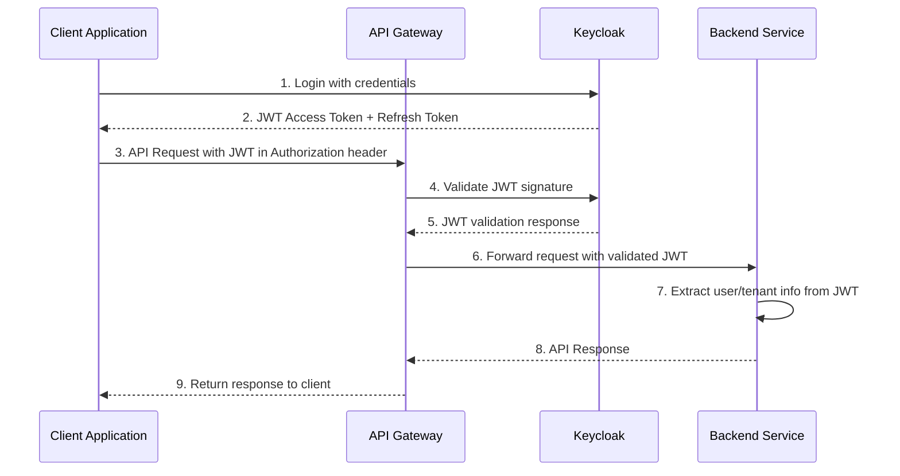

# Service Integration Guide

This guide describes how the Agri Enhancement Platform (AEP) microservices integrate with each other and with external systems.

## Overview

AEP follows a microservices architecture with clear service boundaries and well-defined integration patterns. Services communicate through synchronous REST APIs for request/response operations and asynchronous events for decoupled communication.

## Service Architecture

```
┌─────────────────┐    ┌─────────────────┐    ┌─────────────────┐
│   Client Apps   │    │   API Gateway   │    │  Keycloak IAM   │
│  (Web/Mobile)   │◄──►│  (Spring Cloud  │◄──►│   (AuthN/AuthZ) │
│                 │    │     Gateway)    │    │                 │
└─────────────────┘    └─────────────────┘    └─────────────────┘
                                │
                                ▼
        ┌─────────────────────────────────────────────────┐
        │              Backend Services                   │
        │  ┌─────────────┐  ┌─────────────────────────┐  │
        │  │Farm Plot    │  │Identity & Access        │  │
        │  │Service      │  │Management Service       │  │
        │  │(Port 8081)  │  │(Port 8082)              │  │
        │  └─────────────┘  └─────────────────────────┘  │
        │                                                   │
        │  ┌─────────────┐  ┌─────────────────────────┐  │
        │  │Ag Practices │  │Future Services...       │  │
        │  │Service      │  │                         │  │
        │  │(Future)     │  │                         │  │
        │  └─────────────┘  └─────────────────────────┘  │
        └─────────────────────────────────────────────────┘
                                │
                                ▼
        ┌─────────────────────────────────────────────────┐
        │              Data Layer                         │
        │  ┌─────────────┐  ┌─────────────────────────┐  │
        │  │PostgreSQL   │  │Event Bus (Kafka)        │  │
        │  │+ PostGIS    │  │(Future)                 │  │
        │  │             │  │                         │  │
        │  └─────────────┘  └─────────────────────────┘  │
        └─────────────────────────────────────────────────┘
```

## Authentication and Authorization Flow

### 1. User Authentication



### 2. Service-to-Service Authentication

Services authenticate with each other using client credentials flow:

```yaml
# Service configuration for inter-service communication
spring:
  security:
    oauth2:
      client:
        registration:
          keycloak:
            client-id: ${SERVICE_NAME}-client
            client-secret: ${KEYCLOAK_CLIENT_SECRET}
            authorization-grant-type: client_credentials
        provider:
          keycloak:
            token-uri: ${KEYCLOAK_URL}/realms/master/protocol/openid-connect/token
```

## Service Integration Patterns

### 1. Synchronous REST API Integration

#### Direct Service Calls

For immediate response requirements, services call each other directly:

```java
// Example: Farm Plot Service calling IAM Service
@Service
public class FarmPlotService {
    
    private final IdentityAccessServiceClient iamClient;
    
    public FarmResponse createFarm(CreateFarmRequest request, String jwtToken) {
        // Validate user exists and has required permissions
        UserValidationResponse userValidation = iamClient.validateUser(
            request.getUserId(), 
            jwtToken
        );
        
        if (!userValidation.hasPermission("FARM_CREATE")) {
            throw new AccessDeniedException("Insufficient permissions");
        }
        
        // Create farm logic...
    }
}
```

#### HTTP Client Configuration

```java
@Configuration
public class ServiceClientConfig {
    
    @Bean
    public IdentityAccessServiceClient identityAccessServiceClient() {
        return Feign.builder()
            .requestInterceptor(new JwtTokenInterceptor())
            .decoder(new JacksonDecoder())
            .target(IdentityAccessServiceClient.class, "http://identity-access-service:8082");
    }
}

@FeignClient(name = "identity-access-service")
public interface IdentityAccessServiceClient {
    
    @GetMapping("/v1/users/{userId}/validate")
    UserValidationResponse validateUser(@PathVariable UUID userId);
    
    @GetMapping("/v1/tenants/{tenantId}/exists")
    Boolean tenantExists(@PathVariable UUID tenantId);
}
```

### 2. Asynchronous Event-Driven Integration

#### Event Publishing

Services publish domain events for loose coupling:

```java
@Service
@Transactional
public class FarmPlotService {
    
    private final ApplicationEventPublisher eventPublisher;
    
    public FarmResponse createFarm(CreateFarmRequest request) {
        Farm farm = farmRepository.save(buildFarm(request));
        
        // Publish domain event
        FarmCreatedEvent event = new FarmCreatedEvent(
            farm.getFarmIdentifier(),
            farm.getTenantId(),
            farm.getOwnerReferenceId()
        );
        eventPublisher.publishEvent(event);
        
        return farmMapper.toResponse(farm);
    }
}
```

#### Event Handling

```java
@Component
@Slf4j
public class FarmEventHandler {
    
    @EventListener
    public void handleFarmCreated(FarmCreatedEvent event) {
        log.info("Farm created: {}", event.getFarmIdentifier());
        
        // Update analytics, send notifications, etc.
        // This could be async processing
    }
    
    @Async
    @EventListener
    public void handleFarmCreatedAsync(FarmCreatedEvent event) {
        // Async processing for non-critical operations
        notificationService.sendFarmCreatedNotification(event);
    }
}
```

### 3. Shared Database Integration

#### Cross-Service Queries

For complex queries requiring data from multiple services:

```java
// Read model approach for cross-service data
@Service
public class FarmDashboardService {
    
    private final FarmRepository farmRepository;
    private final IdentityAccessServiceClient iamClient;
    
    public FarmDashboardResponse getFarmDashboard(UUID farmId, String jwtToken) {
        // Get farm data
        Farm farm = farmRepository.findById(farmId)
            .orElseThrow(() -> new EntityNotFoundException("Farm not found"));
        
        // Get user data from IAM service
        UserResponse owner = iamClient.getUser(farm.getOwnerReferenceId(), jwtToken);
        
        // Combine data for dashboard
        return FarmDashboardResponse.builder()
            .farm(farmMapper.toResponse(farm))
            .owner(owner)
            .plotCount(getPlotCount(farmId))
            .build();
    }
}
```

## Data Consistency Patterns

### 1. Transactional Outbox Pattern

For reliable event publishing:

```java
@Entity
@Table(name = "outbox_events")
public class OutboxEvent {
    @Id
    private UUID eventId;
    private String eventType;
    private String eventData;
    private String status; // PENDING, PUBLISHED, FAILED
    private LocalDateTime createdAt;
    private LocalDateTime processedAt;
}

@Service
public class OutboxEventService {
    
    @Transactional
    public void publishEvent(DomainEvent event) {
        // Save event to outbox table
        OutboxEvent outboxEvent = OutboxEvent.builder()
            .eventType(event.getClass().getSimpleName())
            .eventData(objectMapper.writeValueAsString(event))
            .status("PENDING")
            .createdAt(LocalDateTime.now())
            .build();
            
        outboxEventRepository.save(outboxEvent);
    }
    
    @Scheduled(fixedDelay = 1000)
    public void processOutboxEvents() {
        List<OutboxEvent> pendingEvents = outboxEventRepository
            .findByStatusOrderByCreatedAt("PENDING");
            
        for (OutboxEvent event : pendingEvents) {
            try {
                // Publish to message broker
                messageBroker.publish(event.getEventType(), event.getEventData());
                
                // Mark as processed
                event.setStatus("PUBLISHED");
                event.setProcessedAt(LocalDateTime.now());
                outboxEventRepository.save(event);
            } catch (Exception e) {
                log.error("Failed to publish event: {}", event.getEventId(), e);
                event.setStatus("FAILED");
                outboxEventRepository.save(event);
            }
        }
    }
}
```

### 2. Saga Pattern for Distributed Transactions

For complex business transactions spanning multiple services:

```java
@Component
public class CreateFarmSaga {
    
    private final FarmPlotService farmService;
    private final IdentityAccessServiceClient iamClient;
    private final NotificationServiceClient notificationClient;
    
    public SagaOrchestration createFarmWithUser(CreateFarmWithUserRequest request) {
        return SagaOrchestration.begin()
            .step("validateUser")
                .invoke(() -> iamClient.validateUser(request.getUserId()))
                .onSuccess(response -> log.info("User validated"))
                .onFailure(ex -> SagaOrchestration.fail("User validation failed"))
            .step("createFarm")
                .invoke(() -> farmService.createFarm(request.getFarmRequest()))
                .compensate(farmId -> farmService.deleteFarm(farmId))
                .onSuccess(farm -> log.info("Farm created: {}", farm.getFarmIdentifier()))
            .step("sendNotification")
                .invoke(farm -> notificationClient.sendFarmCreatedNotification(farm))
                .onSuccess(() -> log.info("Notification sent"))
            .execute();
    }
}
```

## Error Handling and Resilience

### 1. Circuit Breaker Pattern

```java
@Service
public class ResilientServiceClient {
    
    @CircuitBreaker(name = "identity-service", fallbackMethod = "fallbackValidateUser")
    public UserValidationResponse validateUser(UUID userId) {
        return identityAccessServiceClient.validateUser(userId);
    }
    
    public UserValidationResponse fallbackValidateUser(UUID userId, Exception ex) {
        log.warn("Identity service unavailable, using fallback for user validation: {}", ex.getMessage());
        return UserValidationResponse.builder()
            .valid(false)
            .reason("Service temporarily unavailable")
            .build();
    }
}
```

### 2. Retry Pattern

```java
@Retryable(
    value = {ServiceUnavailableException.class},
    maxAttempts = 3,
    backoff = @Backoff(delay = 1000, multiplier = 2)
)
public FarmResponse createFarm(CreateFarmRequest request) {
    // Implementation that might fail due to temporary issues
}
```

### 3. Timeout Configuration

```yaml
# application.yml
spring:
  cloud:
    openfeign:
      client:
        config:
          default:
            connectTimeout: 5000
            readTimeout: 10000
            loggerLevel: basic
          identity-access-service:
            connectTimeout: 3000
            readTimeout: 7000
```

## Configuration Management

### 1. Service Discovery

```yaml
# For Kubernetes environments
spring:
  cloud:
    kubernetes:
      discovery:
        enabled: true
        all-namespaces: true
```

### 2. Configuration Properties

```yaml
# Service integration configuration
aep:
  services:
    identity-access:
      url: ${IDENTITY_ACCESS_SERVICE_URL:http://localhost:8082}
      timeout: 5000
      retry:
        maxAttempts: 3
        backoff: 1000
    
    farm-plot:
      url: ${FARM_PLOT_SERVICE_URL:http://localhost:8081}
      timeout: 5000
      retry:
        maxAttempts: 3
        backoff: 1000
```

## Monitoring and Observability

### 1. Distributed Tracing

```java
@RestController
public class FarmController {
    
    @NewSpan("create-farm")
    @PostMapping("/farms")
    public ResponseEntity<FarmResponse> createFarm(
            @RequestBody CreateFarmRequest request,
            @SpanTag("user.id") UUID userId,
            @SpanTag("tenant.id") UUID tenantId) {
        
        // Implementation
    }
}
```

### 2. Metrics Collection

```java
@Service
public class ServiceIntegrationMetrics {
    
    private final MeterRegistry meterRegistry;
    private final Counter serviceCallCounter;
    private final Timer serviceCallTimer;
    
    public ServiceIntegrationMetrics(MeterRegistry meterRegistry) {
        this.meterRegistry = meterRegistry;
        this.serviceCallCounter = Counter.builder("service.calls")
            .description("Number of service calls")
            .register(meterRegistry);
        this.serviceCallTimer = Timer.builder("service.call.duration")
            .description("Service call duration")
            .register(meterRegistry);
    }
    
    public <T> T callService(String serviceName, Supplier<T> call) {
        return Timer.Sample.start(meterRegistry)
            .stop(serviceCallTimer)
            .supply(() -> {
                serviceCallCounter.increment(Tags.of("service", serviceName));
                return call.get();
            });
    }
}
```

## Testing Integration

### 1. Contract Testing

```java
@ExtendWith(PactConsumerTestExt.class)
@PactTestFor(providerName = "identity-access-service")
public class IdentityServiceContractTest {
    
    @Pact(consumer = "farm-plot-service")
    public RequestResponsePact validateUserPact(PactDslWithProvider builder) {
        return builder
            .given("user exists and is active")
            .uponReceiving("validate user request")
                .path("/v1/users/123e4567-e89b-12d3-a456-426614174000/validate")
                .method("GET")
                .headers("Authorization", "Bearer ${jwt}")
            .willRespondWith()
                .status(200)
                .headers("Content-Type", "application/json")
                .body(LambdaDsl.newJsonBody(body -> {
                    body.booleanType("valid", true);
                    body.stringType("tenantId", "123e4567-e89b-12d3-a456-426614174000");
                    body.arrayType("permissions", 
                        LambdaDsl.newJsonArray(array -> {
                            array.stringValue("FARM_CREATE");
                            array.stringValue("FARM_READ");
                        })
                    );
                }).build())
            .toPact();
    }
}
```

### 2. Integration Testing

```java
@SpringBootTest
@Testcontainers
class ServiceIntegrationTest {
    
    @Container
    static PostgreSQLContainer<?> postgres = new PostgreSQLContainer<>("postgis/postgis:15-3.3");
    
    @Container
    static GenericContainer<?> keycloak = new GenericContainer<>("quay.io/keycloak/keycloak:25.0.2")
            .withExposedPorts(8080);
    
    @MockBean
    private IdentityAccessServiceClient iamClient;
    
    @Test
    void createFarm_ValidUser_CreatesFarmSuccessfully() {
        // Given
        when(iamClient.validateUser(any())).thenReturn(
            UserValidationResponse.builder()
                .valid(true)
                .tenantId(UUID.randomUUID())
                .permissions(List.of("FARM_CREATE"))
                .build()
        );
        
        // When
        FarmResponse response = farmPlotService.createFarm(createFarmRequest());
        
        // Then
        assertThat(response.getFarmIdentifier()).isNotNull();
        verify(iamClient).validateUser(any());
    }
}
```

## Best Practices

### 1. API Design
- Use versioned APIs (`/v1/`, `/v2/`)
- Implement proper HTTP status codes
- Provide clear error messages
- Use consistent request/response formats

### 2. Security
- Always validate JWT tokens
- Implement proper authorization checks
- Use HTTPS for all service communication
- Rotate secrets regularly

### 3. Performance
- Implement caching for frequently accessed data
- Use connection pooling for database and HTTP clients
- Monitor and optimize slow queries
- Implement proper timeout configurations

### 4. Reliability
- Design for failure with circuit breakers
- Implement retry logic for transient failures
- Use health checks for service monitoring
- Plan for graceful degradation

This integration guide provides the foundation for building robust, scalable, and maintainable microservices integration within the AEP platform.